# Build the PyPI transfer by hand

The PyPI transfer moves Python wheels across a data diode one wheel at a time. The low side takes a small JSON request from the request job of gitlab-pypi-mirror, downloads each wheel from the low package index and checks its SHA-256. The high side checks the wheel again and uploads it to the high index. This guide is for **NiFi 2.12.0** with **PlanPythonTransfer / RoutePythonTransfer 0.2.0**.

The two sides are built on different NiFi instances at work, so the guide is split the same way:

- [Common setup](#common-setup): install the Python processors, once per NiFi instance.
- [Low side](#low-side): the source-side flow, 8 processors and the `to diode` port.
- [High side](#high-side): the destination-side flow, 4 processors and the `from diode` port.
- [The diode link](#the-diode-link): what sits between the two ports, and what you do not build at work.

Each side lists only what you change from NiFi's defaults. A property, setting or queue option that is not listed stays at the value NiFi gives it. Names are exactly as the NiFi UI shows them. Values were read from the live reference flow on nifi-dev on 2026-10-21 (process group `research 2026-10-21 pypi custom processors`), except index addresses and credentials, which are examples. What each processor reads and writes is in the [README](../../README.md#attributes).

`#{name}` is a **Parameter Context** reference. `${name}` is **FlowFile Expression Language**. Copy both forms exactly. Property names and relationship names are case-sensitive.

## Common setup

### Install the Python processors on every node

Copy the **whole** `python/python-packages` directory, including its helper modules, into NiFi's Python extensions directory on every node. Copying just the two processor files is not enough.

```sh
git clone https://github.com/djlongy/nifi-python-package-processors.git
cd nifi-python-package-processors
cp -R python/python-packages /opt/nifi/nifi-current/python_extensions/
```

Adjust the destination to `nifi.python.extensions.source.directory.default` in `nifi.properties`, run the copy as the NiFi service account, then restart NiFi: it discovers Python processors at start. On a cluster, install the same files on **every node** and wait until both types appear at **0.2.0** in **Add Processor**. For containers, build `python/Containerfile` and copy `/extensions/python-packages` from an init container, so a restart does not lose the files.

The low side needs **PlanPythonTransfer** and **RoutePythonTransfer**. The high side needs **RoutePythonTransfer** only. Everything else is a standard NiFi processor.

## Low side

The low side reads the low index. It is built on the low NiFi instance, inside one process group. The reference group is `pypi custom-low`.

How it works: the mirror's request job (or the stopped `Resend` card) delivers a small request. `PlanPythonTransfer` checks it and writes one job per wheel, `SplitJson` makes one FlowFile per job, and `RoutePythonTransfer` sends each job to `InvokeHTTP`, which downloads the wheel. `CryptographicHashContent` hashes the bytes, and `RoutePythonTransfer` labels the wheel and releases it to `to diode` once the hash matches the request. Anything refused waits in the queue in front of a stopped `LogMessage`.

### Low screenshot

The live, empty-queue `pypi custom-low` canvas. Click it to open it at full size. Connection labels show the selected relationships. The toolbar statistics describe the whole NiFi instance.

[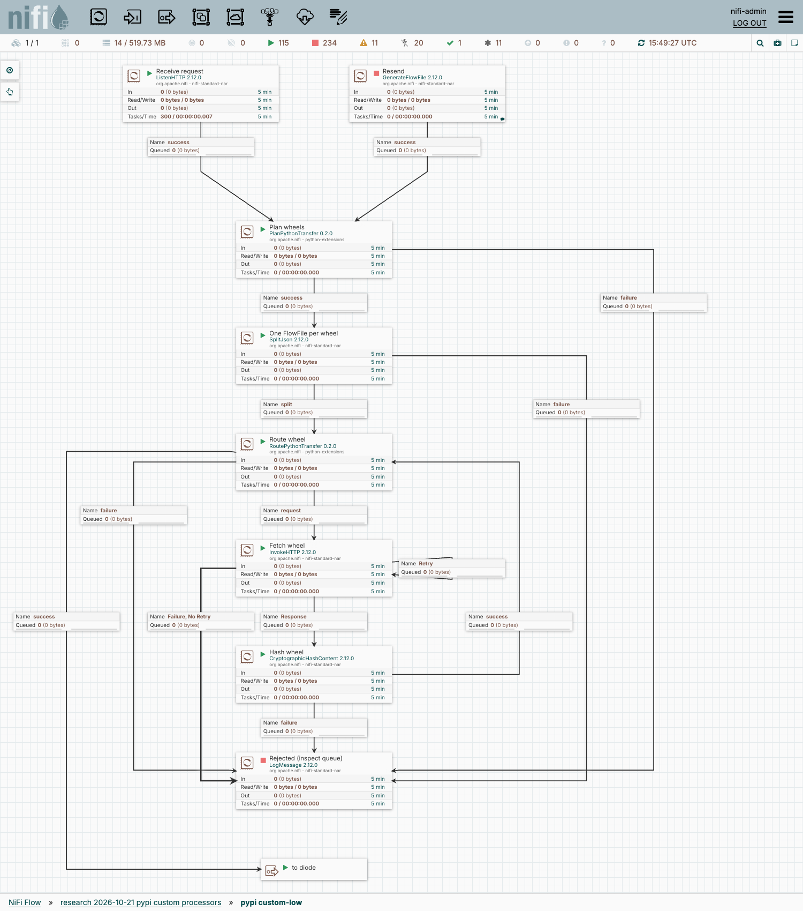](../images/pypi-low-side.png)

### L1. Create the group and parameters

On the low NiFi instance, create a **Process Group** (the reference uses `pypi custom-low`) and build everything below inside it. Open **Global menu, Parameter Contexts, +** and create a context holding only the low-side parameters. Bind it with **the group, Configure, Parameter Context**. Do not put high-side credentials here.

| Parameter | Sensitive | Example value / purpose |
|---|---|---|
| `gitlab.low.pypi.url` | No | `https://gitlab.example.com/api/v4/projects/12/packages/pypi`, the low index, with no trailing slash |
| `gitlab.username` | No | `__token__` for a GitLab token |
| `gitlab.low.token` | **Yes** | A token that can read the low project's packages |
| `request.path` | No | `pypi-request`, the listener's base path |

The index address, user and token come from this context, **never from the request**. The wheel urls in a request must start with `#{gitlab.low.pypi.url}/files/`, so a request cannot point NiFi at another host.

**Private CA.** If the index certificate chains to a public CA, leave every **SSL Context Service** blank, as the reference flow does. For a private CA, follow [TLS and private CAs](../../README.md#tls-and-private-cas) and select the service on `PlanPythonTransfer` and on `InvokeHTTP`. RoutePythonTransfer makes no connection and has no SSL property.

### L2. Add the cards

Use **Add Processor**, search for the type and pick the exact version. Name each card as the table shows (**Configure, Settings, Name**): the names match the screenshots and do not change behaviour. Add the output port with the toolbar **Output Port** control and name it `to diode`.

| Type | Version | Name | Initial state |
|---|---|---|---|
| ListenHTTP | 2.12.0 | `Receive request` | Stopped while configuring |
| GenerateFlowFile | 2.12.0 | `Resend` | Stopped (never Start it) |
| PlanPythonTransfer | 0.2.0 | `Plan wheels` | Stopped while configuring |
| SplitJson | 2.12.0 | `One FlowFile per wheel` | Stopped while configuring |
| RoutePythonTransfer | 0.2.0 | `Route wheel` | Stopped while configuring |
| InvokeHTTP | 2.12.0 | `Fetch wheel` | Stopped while configuring |
| CryptographicHashContent | 2.12.0 | `Hash wheel` | Stopped while configuring |
| LogMessage | 2.12.0 | `Rejected (inspect queue)` | **Stopped, always** |

**`Rejected (inspect queue)` is a parking place, not a processor you run.** Refused requests and wheels wait in its input queues with their content and attributes, `pypi.error` saying why. Starting it would log each one and discard it.

### L3. Settings and scheduling changed from default

Everything not listed here stays at NiFi's default: Scheduling Strategy `Timer driven`, Run Schedule `0 sec`, Concurrent Tasks `1`, Execution `All nodes`, Penalty Duration `30 sec`, Yield Duration `1 sec`, Bulletin Level `WARN`, no automatic relationship retries.

| Card | Tab, setting | Value |
|---|---|---|
| Plan wheels | Scheduling, Run Duration | `25 ms` |
| Route wheel | Scheduling, Run Duration | `25 ms` |
| Rejected (inspect queue) | Scheduling, Run Duration | `25 ms` |
| Resend | Scheduling, Run Schedule | `1 day` |
| Resend | Scheduling, Execution | `Primary node` on a cluster (see [L9](#l9-resend-from-nifi)) |
| Resend | Comments | `Stopped. Put wheel file names in Custom Text, one per line, then right-click Run Once.` |

### L4. Enter the properties

Open **Configure, Properties** on each card. Each table lists only the properties you change or must see. The count of changed properties is in each heading.

#### Receive request (ListenHTTP): 3 properties

| Property | Value |
|---|---|
| Base Path | `#{request.path}` |
| Listening Port | `9311` |
| HTTP Headers for Attributes | `(?i)x-.*` |

[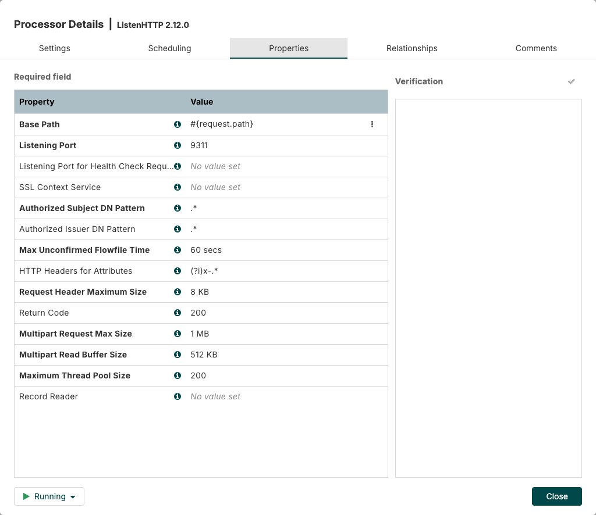](../images/pypi-listenhttp-properties.png)

`HTTP Headers for Attributes` turns the request's `X-Artifact-Type`, `X-Artifact-Format`, `X-Sha256` and audit headers into attributes. Without it PlanPythonTransfer refuses every request. Return Code stays at `200`. ListenHTTP listens on plain HTTP in the reference flow, and it does not check the `Authorization` header the mirror sends with `MIRROR_REQUEST_TOKEN`: terminate HTTPS at an ingress, restrict the sender there, and route only the exact path to port 9311. Every node reserves the port, so pick one no other listener uses (the side-by-side request PoC on nifi-dev uses 9310).

#### Plan wheels (PlanPythonTransfer): 4 properties

| Property | Value |
|---|---|
| Allowed URL Base | `#{gitlab.low.pypi.url}/files/` |
| Index URL | `#{gitlab.low.pypi.url}` |
| Index Username | `#{gitlab.username}` |
| Index Password | `#{gitlab.low.token}` (shows as "Sensitive value set") |

[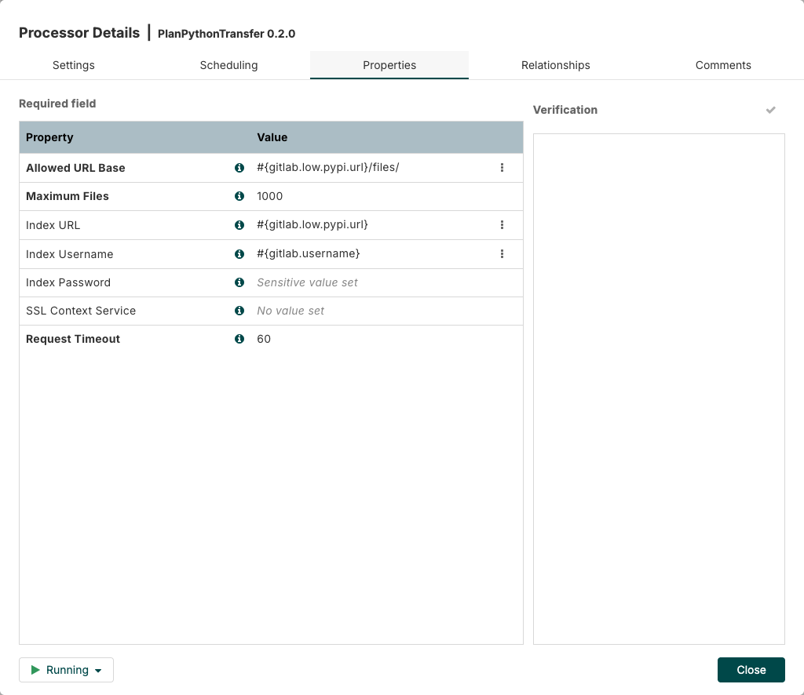](../images/pypi-plan-properties.png)

Maximum Files (`1000`, the mirror sends 200) and Request Timeout (`60` seconds) stay at their defaults. Index URL, Index Username and Index Password are read only for a `text` request from `Resend`: the processor looks each wheel name up on the index's `/simple/<project>/` page. Leave them empty if you never resend from NiFi, and a `text` request is then refused. A wheel url outside Allowed URL Base, or with a malformed filename or sha256, is refused alone, and the rest of the request still goes.

#### One FlowFile per wheel (SplitJson): 1 property

| Property | Value |
|---|---|
| JsonPath Expression | `$.jobs` |

This splits the small job list, never a wheel.

#### Route wheel (RoutePythonTransfer): 0 properties

All properties stay at their defaults: Transfer Side `Low`, Upload URL empty, Already Uploaded Pattern unchanged (used on the high side only), Accepted Formats `whl`, Upload Secret empty. Set Accepted Formats to `whl,sdist` only if the mirror sends source distributions (`MIRROR_PUBLISH_SDISTS=true`).

[](../images/pypi-route-low-properties.png)

| Relationship | Condition on the low side | Goes to |
|---|---|---|
| `request` | A job ready for InvokeHTTP GET `${pypi.url}` | Fetch wheel |
| `success` | A downloaded wheel whose SHA-256 matched, labelled for the diode | Output Port `to diode` |
| `failure` | Refused: allowlist, sha256 mismatch or not a wheel. `pypi.error` says why | Rejected (inspect queue) |
| `original` | Not used | Auto-terminate |

#### Fetch wheel (InvokeHTTP): 5 properties

| Property | Value |
|---|---|
| HTTP Method | `GET` (the default, listed so you check it) |
| HTTP URL | `${pypi.url}` |
| Socket Read Timeout | `5 mins` |
| Request Username | `#{gitlab.username}` |
| Request Password | `#{gitlab.low.token}` (shows as "Sensitive value set") |

[](../images/pypi-fetch-properties.png)

[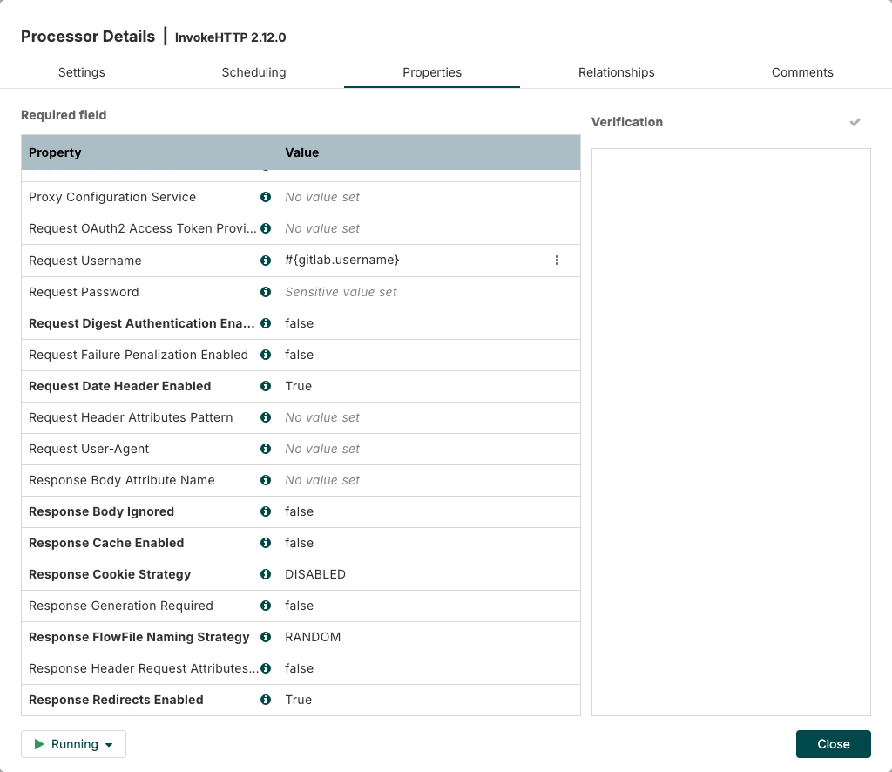](../images/pypi-fetch-properties-2.png)

The dialog scrolls: the second screenshot is the same tab scrolled to the end. HTTP URL is the wheel url RoutePythonTransfer copies from the request job, already checked against Allowed URL Base. Enter `${pypi.url}` exactly, never the index address. Leave Response Redirects Enabled at `True`, Response Body Attribute Name empty (a wheel must never be copied into an attribute) and Request Header Attributes Pattern empty (forwarding attributes as headers could leak them). Credentials stay on this card as parameters and are never written to an attribute.

#### Hash wheel (CryptographicHashContent): 0 properties

Hash Algorithm stays `SHA-256` and Fail When Content Empty `false`. It writes `content_SHA-256`, which RoutePythonTransfer compares with the request's sha256 before release.

#### Rejected (inspect queue) (LogMessage): 2 properties

| Property | Value |
|---|---|
| Log Level | `warn` |
| Log Message | `pypi custom-low rejected ${filename} ${pypi.filename}: ${pypi.error} (HTTP ${invokehttp.status.code})` |

#### Resend (GenerateFlowFile): 3 properties

| Property | Value |
|---|---|
| Custom Text | Wheel file names, one per line, such as `six-1.17.0-py2.py3-none-any.whl` |
| X-Artifact-Type (dynamic) | `python-packages-request` |
| X-Artifact-Format (dynamic) | `text` |

Add the two `X-` properties with **Properties, +**. Leave Mime Type empty and Batch Size at `1`.

[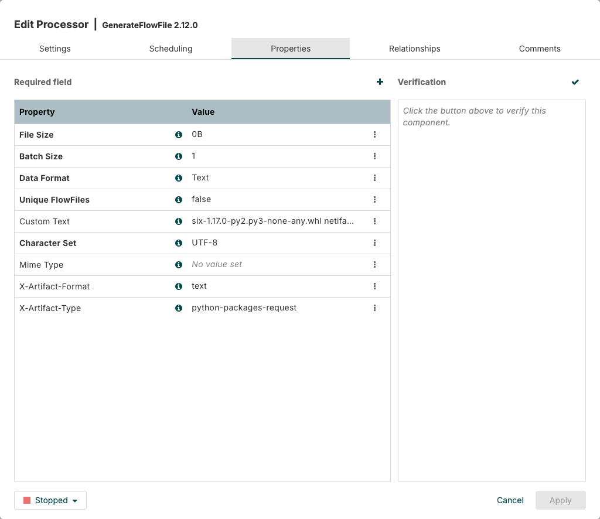](../images/pypi-resend-properties.png)

### L5. Connections

Drag from a source card's handle to its destination and choose the exact relationships in **Details**. Leave the connection name blank: the canvas shows the selected relationships. A row with several relationships is **one connection** with all of them selected. Every connection keeps NiFi's default queue settings (Back Pressure Object Threshold `10000`, Size Threshold `1 GB`, no expiration). Keep the default on every connection in a loop: NiFi does not schedule a processor whose outgoing connection is full, so small limits round a loop deadlock it.

| # | Source | Selected relationships | Destination |
|---|---|---|---|
| L1 | Receive request | `success` | Plan wheels |
| L2 | Resend | `success` | Plan wheels |
| L3 | Plan wheels | `success` | One FlowFile per wheel |
| L4 | Plan wheels | `failure` | Rejected (inspect queue) |
| L5 | One FlowFile per wheel | `split` | Route wheel |
| L6 | One FlowFile per wheel | `failure` | Rejected (inspect queue) |
| L7 | Route wheel | `request` | Fetch wheel |
| L8 | Route wheel | `success` | Output Port `to diode` |
| L9 | Route wheel | `failure` | Rejected (inspect queue) |
| L10 | Fetch wheel | `Response` | Hash wheel |
| L11 | Fetch wheel | `Retry` | Fetch wheel (itself) |
| L12 | Fetch wheel | `Failure`, `No Retry` | Rejected (inspect queue) |
| L13 | Hash wheel | `success` | Route wheel |
| L14 | Hash wheel | `failure` | Rejected (inspect queue) |

InvokeHTTP uses capitalised relationship names, the other processors lower case. `Retry` (HTTP 5xx) loops on Fetch wheel itself, and InvokeHTTP penalises it between attempts. `No Retry` (HTTP 4xx, such as a bad token or a wheel gone from the index) and `Failure` (no answer) are parked for an operator.

### L6. Auto-termination

In each processor's **Configure, Relationships**, tick **Terminate** only on these. No unconnected relationship may stay unterminated, or its processor stays invalid.

| Processor | Auto-terminate |
|---|---|
| Receive request | None |
| Resend | None |
| Plan wheels | `original` |
| One FlowFile per wheel | `original` |
| Route wheel | `original` |
| Fetch wheel | `Original` |
| Hash wheel | None |
| Rejected (inspect queue) | `success` (the processor stays stopped) |

### L7. Layout

Put the main route in one column: Plan wheels, One FlowFile per wheel, Route wheel, Fetch wheel, Hash wheel, Rejected (inspect queue), then `to diode` at the bottom. Put Receive request and Resend side by side above Plan wheels. Send the return line from Hash wheel to Route wheel, and the failure lines into Rejected, down outer lanes so labels stay clear of cards. Approximate top-left canvas coordinates from the live canvas:

| Card | X | Y |
|---|---|---|
| Receive request | 0 | 0 |
| Resend | 512 | 0 |
| Plan wheels | 256 | 352 |
| One FlowFile per wheel | 256 | 592 |
| Route wheel | 256 | 832 |
| Fetch wheel | 256 | 1072 |
| Hash wheel | 256 | 1312 |
| Rejected (inspect queue) | 256 | 1552 |
| Output Port `to diode` | 312 | 1792 |

### L8. Connect the mirror and start

Expose the listener through an HTTPS ingress, for example `https://nifi.example.com/pypi-request` routed to backend port 9311 over HTTP. In the gitlab-pypi-mirror project, set `MIRROR_REQUEST_URL` to that URL (and `MIRROR_REQUEST_CA_BUNDLE` for a private CA). Each sync then ends with small JSON POSTs, `MIRROR_REQUEST_BATCH` wheels each (default 200), carrying `X-Artifact-Type: python-packages-request`, `X-Artifact-Format: json` and `X-Sha256` of the body. HTTP 200 means the listener accepted the request, not that the wheels arrived.

Start the high side first ([H7](#h7-start-and-verify-the-high-side)). Then start every low card and `to diode`, keeping `Rejected (inspect queue)` and `Resend` **stopped**. Run the mirror pipeline and check:

| Signal | Expected result |
|---|---|
| Mirror request job | HTTP 200 per batch, and the ledger records each batch |
| Plan wheels | One job list per request, `pypi.job.count` and `pypi.refused.count` set |
| Fetch wheel and Hash wheel | One download and one hash per wheel |
| `to diode` | One FlowFile per wheel, with `filename`, `X-Sha256`, `X-Artifact-Type` `python-packages`, `X-Artifact-Format` `whl` |
| Queues into Rejected (inspect queue) | Empty after success. Any held FlowFile has `pypi.error` |

### L9. Resend from NiFi

The pipeline resends with `MIRROR_RESEND_PACKAGES` or `MIRROR_RESEND_ALL=true`. Without the pipeline, use the stopped `Resend` card wired to Plan wheels by L2:

1. Leave the flow running and `Rejected (inspect queue)` stopped.
2. Open `Resend`, **Configure, Properties**, and put the wheel file names in Custom Text, one per line (`#` comments are allowed). Apply.
3. Right-click `Resend` and choose **Run Once**. Never click Start.
4. Check that one request went in and that each named wheel leaves through `to diode`.

Each name is looked up on Index URL's `/simple/<project>/` page, then goes through the same allowlist, fetch and SHA-256 checks as a request from the pipeline. A link the index gives under Index URL's path is read from Index URL's host, because GitLab writes its own `external_url` into the page. On a cluster, set Execution to `Primary node`, or Run Once makes one request on **each** node. The reference instance is a single node and leaves Execution at `All nodes`.

## High side

The high side writes to the high index. It is built on the high NiFi instance, inside one process group. The reference group is `pypi custom-high`.

How it works: each wheel arrives in `from diode` as a plain FlowFile with the attributes the low side set. `CryptographicHashContent` hashes it, `RoutePythonTransfer` checks that it is a wheel and that its bytes match `X-Sha256`, then `InvokeHTTP` posts it to the index with the standard upload form `twine` uses. `RoutePythonTransfer` reads the answer: uploaded, or already in the index, both count as done.

**At work this group is reached by routing on `X-Artifact-Type`.** The high-side diode receiver delivers every artifact type into one place. A `RouteOnAttribute` there sends `X-Artifact-Type` = `python-packages` to this group's `from diode` port, for example with Routing Strategy `Route to Property name` and a dynamic property `python-packages` = `${X-Artifact-Type:equals('python-packages')}`. Container images and other types take their own routes.

### High screenshot

The live, empty-queue `pypi custom-high` canvas. Click it to open it at full size.

[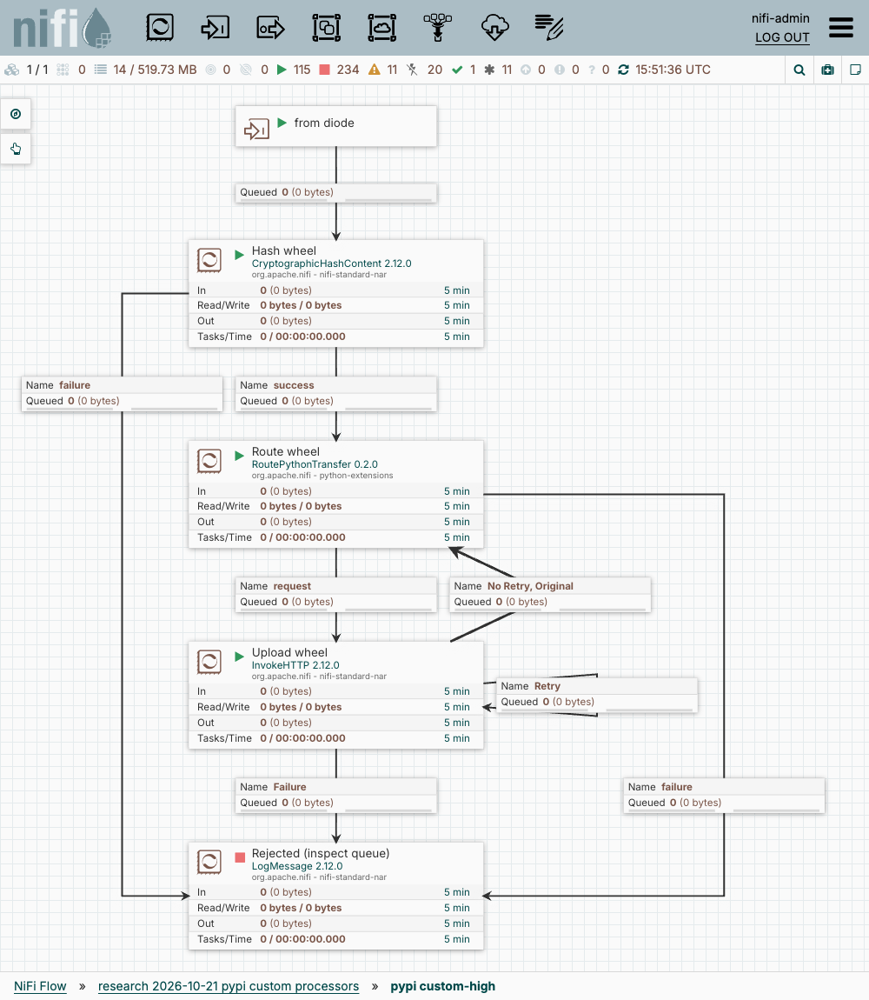](../images/pypi-high-side.png)

### H1. Create the group and parameters

On the high NiFi instance, create a **Process Group** (the reference uses `pypi custom-high`) and a context holding only the high-side parameters. Bind it to the group. Do not copy low-side credentials here.

| Parameter | Sensitive | Example value / purpose |
|---|---|---|
| `gitlab.high.pypi.url` | No | `https://gitlab.example.com/api/v4/projects/34/packages/pypi`, the high index's upload URL |
| `gitlab.username` | No | `__token__` for a GitLab token |
| `gitlab.high.token` | **Yes** | A token that can write the high project's packages |

For a private CA, select a StandardSSLContextService on `Upload wheel` as in [TLS and private CAs](../../README.md#tls-and-private-cas). The reference flow leaves it empty.

### H2. Add the cards

Add the input port with the toolbar **Input Port** control and name it `from diode`.

| Type | Version | Name | Initial state |
|---|---|---|---|
| CryptographicHashContent | 2.12.0 | `Hash wheel` | Stopped while configuring |
| RoutePythonTransfer | 0.2.0 | `Route wheel` | Stopped while configuring |
| InvokeHTTP | 2.12.0 | `Upload wheel` | Stopped while configuring |
| LogMessage | 2.12.0 | `Rejected (inspect queue)` | **Stopped, always** |

### H3. Settings and scheduling changed from default

Defaults as on the low side, except:

| Card | Tab, setting | Value |
|---|---|---|
| Route wheel | Scheduling, Run Duration | `25 ms` |
| Rejected (inspect queue) | Scheduling, Run Duration | `25 ms` |

### H4. Enter the properties

#### Hash wheel (CryptographicHashContent): 0 properties

Defaults: Hash Algorithm `SHA-256`, Fail When Content Empty `false`. The high side hashes the wheel again: it trusts the bytes it received, not the low side's word.

#### Route wheel (RoutePythonTransfer): 3 properties

| Property | Value |
|---|---|
| Transfer Side | `High` |
| Upload URL | `#{gitlab.high.pypi.url}` |
| Upload Secret | `#{pypi.upload.secret}`, a sensitive parameter of 32 or more characters (needed on a cluster or with Concurrent Tasks above 1) |

[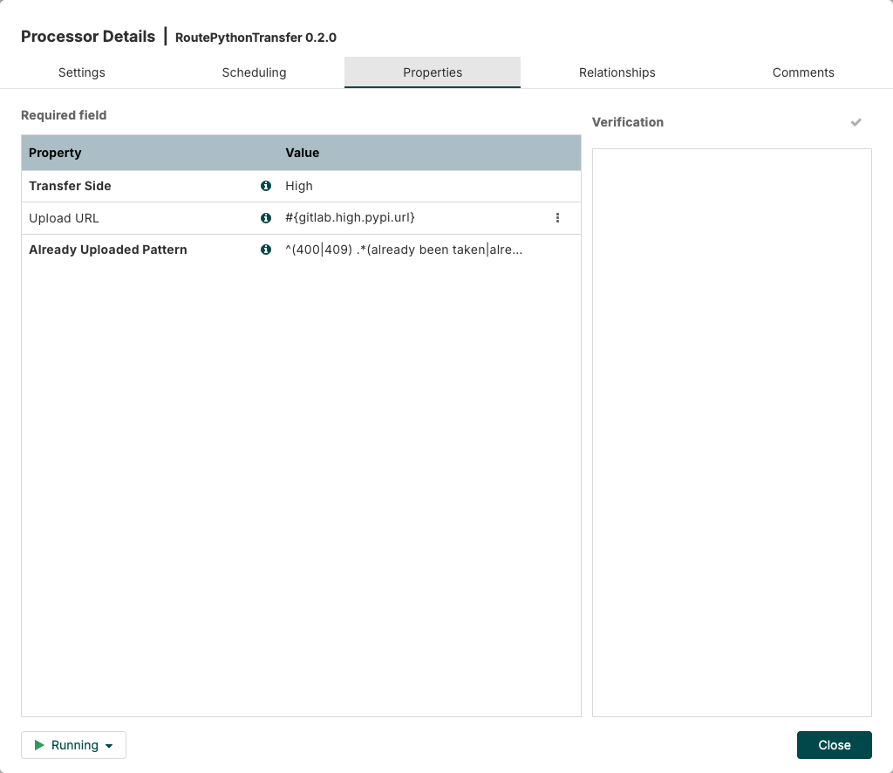](../images/pypi-route-high-properties.png)

Upload URL must be exactly the HTTP URL of `Upload wheel`: an answer from any other URL is refused, so attributes carried across the diode cannot pass as an upload answer. Already Uploaded Pattern stays at its default, `^(400|409) .*(already been taken|already exists|does not allow updating)`, which covers GitLab, PyPI, pypiserver, Artifactory and Nexus.

| Relationship | Condition on the high side | Goes to |
|---|---|---|
| `request` | A checked wheel ready for InvokeHTTP POST | Upload wheel |
| `success` | Uploaded, or already in the index (`pypi.result` `uploaded` or `duplicate`) | Auto-terminate |
| `failure` | Not a wheel, sha256 mismatch, or an upload the index rejected. `pypi.error` says why | Rejected (inspect queue) |
| `original` | Not used | Auto-terminate |

#### Upload wheel (InvokeHTTP): 13 properties

Add the five `post:form:` properties with **Properties, +** as dynamic properties. Each becomes one field of the multipart upload form.

| Property | Value |
|---|---|
| HTTP Method | `POST` |
| HTTP URL | `#{gitlab.high.pypi.url}` |
| Socket Read Timeout | `5 mins` |
| Socket Write Timeout | `5 mins` |
| Request Username | `#{gitlab.username}` |
| Request Password | `#{gitlab.high.token}` (shows as "Sensitive value set") |
| Request Multipart Form-Data Name | `content` |
| Response Body Attribute Name | `pypi.response` |
| post:form::action (dynamic) | `file_upload` |
| post:form:name (dynamic) | `${pypi.name}` |
| post:form:protocol_version (dynamic) | `1` |
| post:form:sha256_digest (dynamic) | `${content_SHA-256}` |
| post:form:version (dynamic) | `${pypi.version}` |

[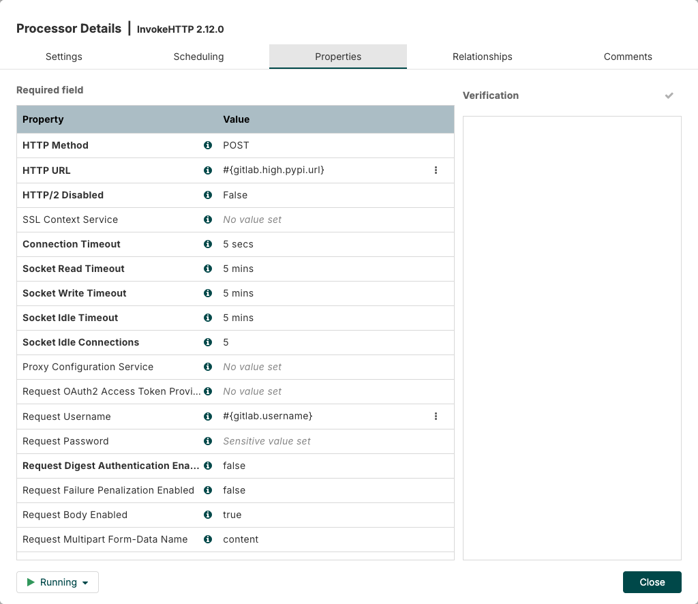](../images/pypi-upload-properties.png)

[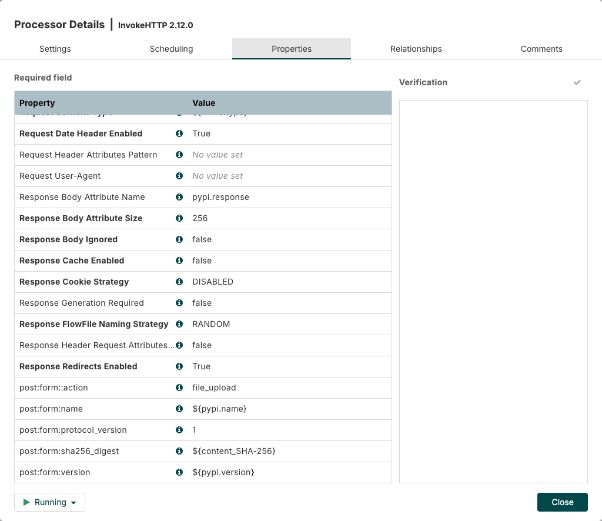](../images/pypi-upload-properties-2.png)

The dialog scrolls: the second screenshot is the same tab scrolled to the end, with the five form fields. Request Multipart Form-Data Filename Enabled stays `true`, so the wheel goes up under its `filename`. Request Content-Type stays `${mime.type}` and Response Body Attribute Size `256`. `post:form::action` has two colons: the field name is `:action`. PyPI and pypiserver need `:action` and `protocol_version`, GitLab ignores them. RoutePythonTransfer reads `pypi.name` and `pypi.version` again from the wheel's file name and clears `pypi.response` before the upload, so nothing from the low side decides what is uploaded or how the answer is read.

#### Rejected (inspect queue) (LogMessage): 2 properties

| Property | Value |
|---|---|
| Log Level | `warn` |
| Log Message | `pypi custom-high rejected ${filename}: ${pypi.error}` |

### H5. Connections

Default queue settings everywhere, as on the low side.

| # | Source | Selected relationships | Destination |
|---|---|---|---|
| H1 | Input Port `from diode` | None (port) | Hash wheel |
| H2 | Hash wheel | `success` | Route wheel |
| H3 | Hash wheel | `failure` | Rejected (inspect queue) |
| H4 | Route wheel | `request` | Upload wheel |
| H5 | Route wheel | `failure` | Rejected (inspect queue) |
| H6 | Upload wheel | `Original`, `No Retry` | Route wheel |
| H7 | Upload wheel | `Retry` | Upload wheel (itself) |
| H8 | Upload wheel | `Failure` | Rejected (inspect queue) |

`No Retry` goes back to Route wheel on purpose: an index answers a file it already holds with HTTP 400 or 409, and Route wheel reads that answer against Already Uploaded Pattern. A duplicate counts as done, any other 4xx goes to `failure` with the index's answer in `pypi.error`.

### H6. Auto-termination

| Processor | Auto-terminate |
|---|---|
| Hash wheel | None |
| Route wheel | `original`, `success` |
| Upload wheel | `Response` |
| Rejected (inspect queue) | `success` (the processor stays stopped) |

Lay the cards out in one column: `from diode` (X 56, Y 0), Hash wheel (0, 160), Route wheel (0, 400), Upload wheel (0, 640), Rejected (0, 880).

### H7. Start and verify the high side

Start `from diode` and every high card, keeping `Rejected (inspect queue)` **stopped**. Then start the low side and send a small request. Check:

| Signal | Expected result |
|---|---|
| Route wheel | Each wheel passes twice: once to `request`, once more after the upload to `success` |
| High index | Every wheel present, with the sha256 the request named |
| A wheel sent twice | `pypi.result` `duplicate`, not a failure |
| Queues into Rejected (inspect queue) | Empty after success. Any held FlowFile has `pypi.error` |

## The diode link

The transfer groups **send and receive plain FlowFiles**. The low group ends at its `to diode` output port and the high group starts at its `from diode` input port. Neither packs nor unpacks anything. The diode link carries each FlowFile with its attributes, so the wheel arrives on the high side with the same `filename`, `X-Sha256`, `X-Artifact-*` and `pypi.*` attributes it left with.

**At work the diode already does this**: it carries FlowFile v3 with attributes. Connect `to diode` to your diode sender and the diode receiver (through the `X-Artifact-Type` route above) to `from diode`. Do not add PackageFlowFile or UnpackContent around the transfer groups.

**On nifi-dev the link is emulated.** The reference flow sits next to an emulated diode (`diode-low`, `diode-high`) and two link groups that stand in for the work diode's FlowFile v3 handling:

[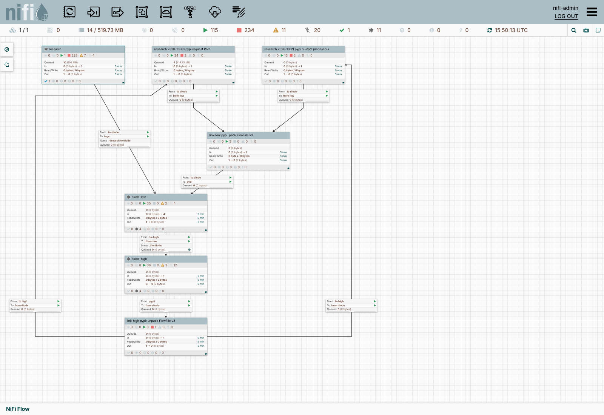](../images/pypi-root-canvas.png)

The transfer groups sit inside `research 2026-10-21 pypi custom processors`, whose own `to diode` and `from diode` ports connect them to the link groups on the root canvas:

[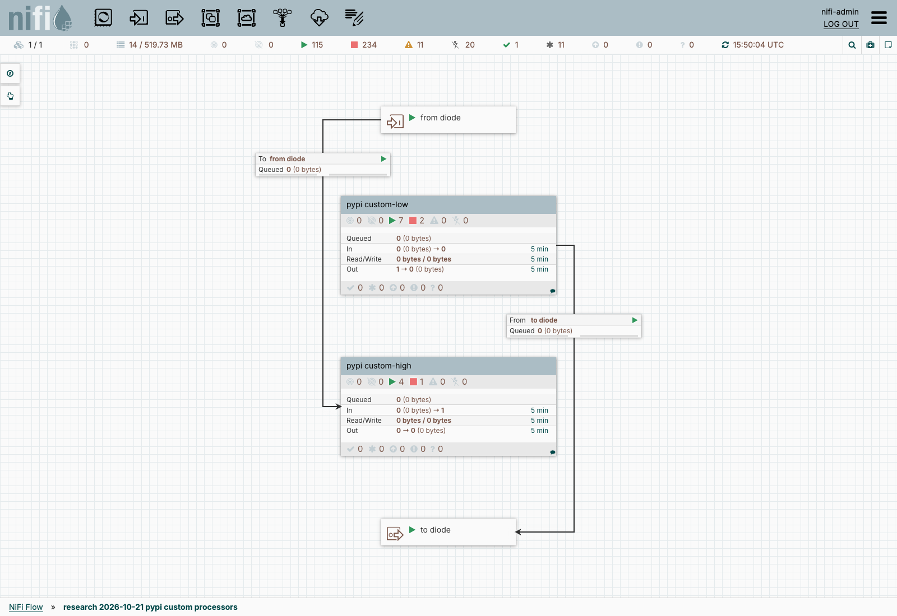](../images/pypi-research-group.png)

| Group | Contents | Purpose |
|---|---|---|
| `link-low pypi: pack FlowFile v3` | Input port `from low`, PackageFlowFile (Maximum Batch Size `1`), output port `to diode` to diode-low's `pypi` port | Packs each FlowFile with its attributes, as the work diode does |
| `link-high pypi: unpack FlowFile v3` | Input port `from diode` from diode-high's `pypi` port, UnpackContent (Packaging Format `flowfile-stream-v3`), output port `to high` | Restores each FlowFile and its attributes. `failure` waits at a stopped LogMessage `Not FlowFile v3 (inspect queue)` |

[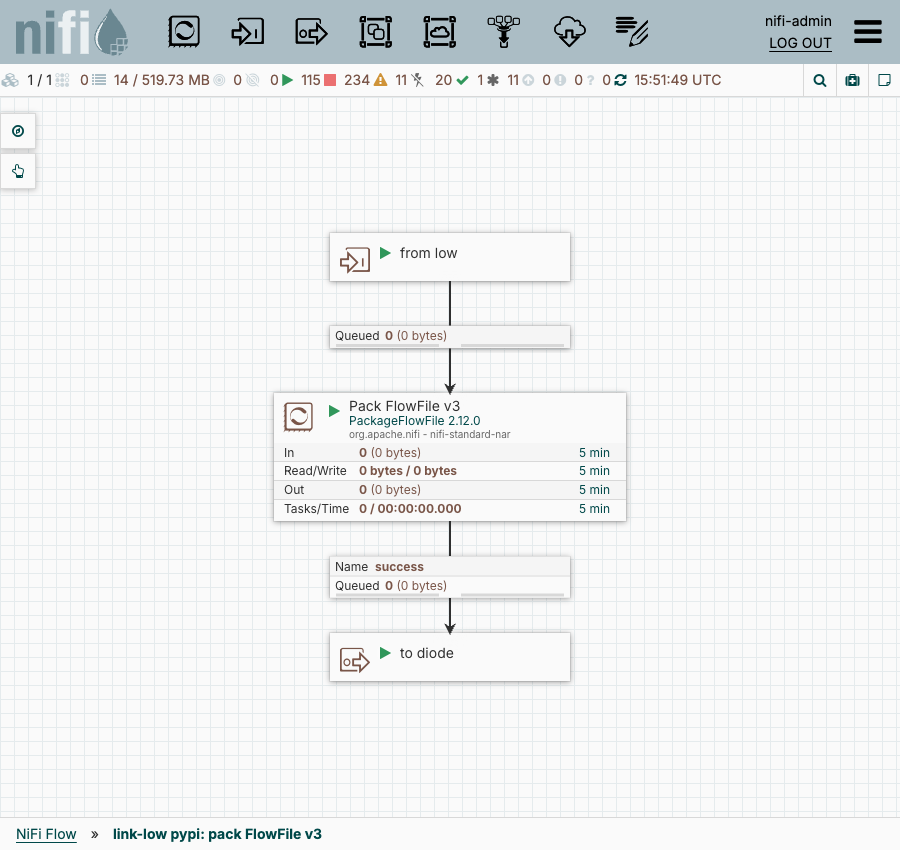](../images/pypi-link-low.png)

[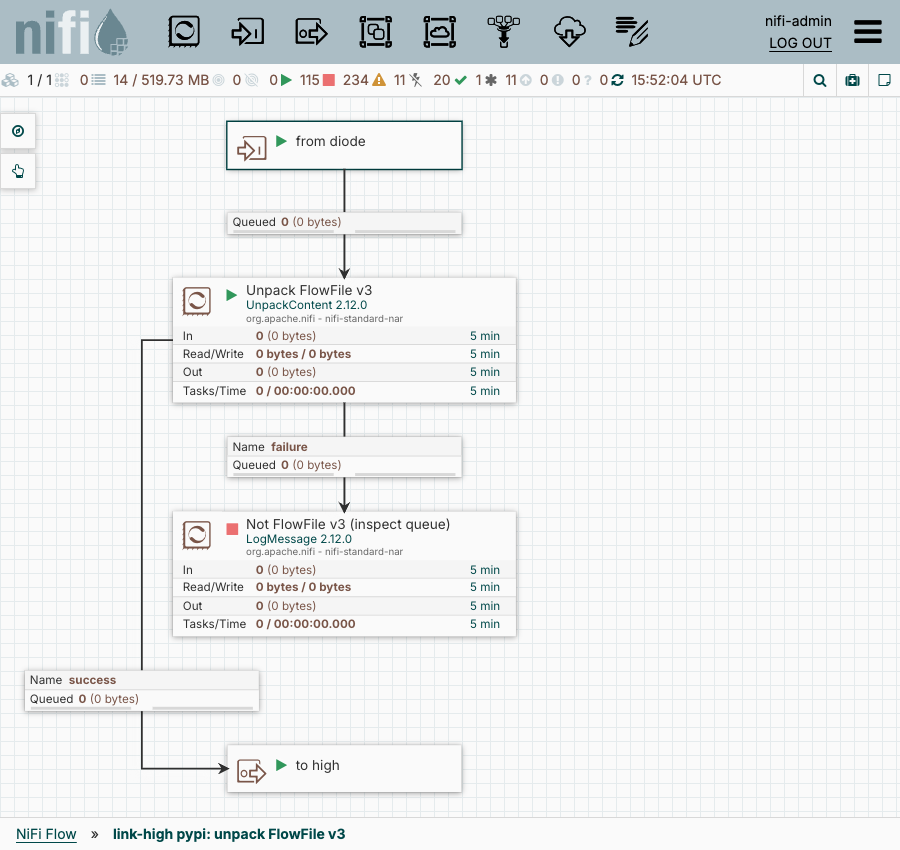](../images/pypi-link-high.png)

Build these two groups only to test without the work diode.

## Troubleshooting

Keep refused FlowFiles in place while you read `pypi.error` and the bulletin. Do not start `Rejected (inspect queue)`, empty its queues, or auto-terminate an extra relationship to make the canvas green.

| Symptom | Check or action |
|---|---|
| Mirror request job gets connection refused | ListenHTTP stopped, wrong port, or the ingress does not route the exact path to 9311 |
| Every request lands in Rejected with `not a Python package request` | HTTP Headers for Attributes does not match `X-` headers, or the ingress strips them |
| `request body does not match its X-Sha256` | The body changed in transit (a proxy re-encoding it), or a hand-made request hashed different bytes |
| One wheel refused, `is not under ...` | Its url is outside Allowed URL Base. Check `#{gitlab.low.pypi.url}` matches the project the mirror publishes to |
| Fetch wheel `No Retry` with HTTP 401 or 403 | Token missing, expired or without read access to the low project |
| A `text` resend refused | Index URL, Index Username or Index Password empty or wrong, or the file name is not on the index |
| High `does not match its X-Sha256` | The bytes changed across the link. Resend the wheel from the low side |
| High upload refused with HTTP 400 that is not a duplicate | Upload URL and HTTP URL differ, a form field is missing, or the token cannot write the high project. `pypi.error` holds the index's answer |
| PKIX or certificate errors | Select a StandardSSLContextService holding the full chain, on PlanPythonTransfer and InvokeHTTP. A selected truststore replaces Java's default CAs on InvokeHTTP |
| link-high's LogMessage queue fills (nifi-dev only) | Something reached the link that was not packed as FlowFile v3 |

Once the cause is fixed, resend from the pipeline or from `Resend` ([L9](#l9-resend-from-nifi)), then empty the held queue. The high side skips wheels the index already holds.
